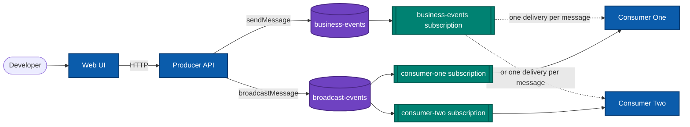
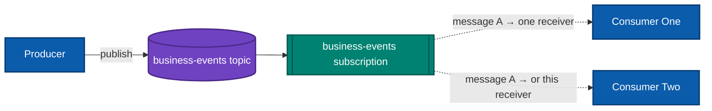
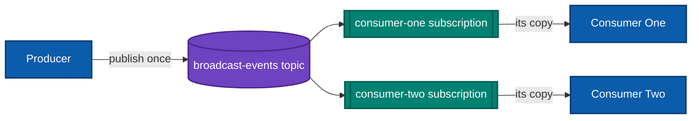

# Azure Service Bus Topics — Patterns in Practice

<p align="center">
  <strong>A small, runnable .NET Aspire app for seeing what Azure Service Bus topics actually do.</strong>
  <br />
  Compare <em>competing consumers</em> with <em>publish/subscribe</em>, send messages from a web UI, and follow each delivery in the Aspire dashboard — no Azure subscription required for the local demo.
</p>

<p align="center">
  
  
  
</p>

## What you'll learn

- How a **topic** fans messages out to its **subscriptions**.
- Why consumers sharing one subscription compete for each message.
- How independent subscriptions give each consumer its own copy.
- How to publish with `ServiceBusSender` and receive with `ServiceBusProcessor`.
- How .NET Aspire wires the producer, consumers, and local Service Bus emulator together.

## The app at a glance



The Web UI calls the Producer API. The API publishes to one of two topics; each topic's subscription topology determines which consumer receives the message. Aspire creates the local resources and supplies connection configuration to the services.

## Pattern 1: Competing consumers

**One topic → one shared subscription → multiple consumers.** Consumer One and Consumer Two both receive from `business-events/business-events`. For each message, Service Bus delivers it to **one** receiver on that subscription, not a copy to both. This lets you scale out workers that perform the same kind of work.



Both consumers attach to the same subscription name in [AppHost.cs](ServiceBusDemo.AppHost/AppHost.cs):

```csharp
var beTopic = asb.AddServiceBusTopic("businessEvent", topicName: "business-events");
var beSub = beTopic.AddServiceBusSubscription("business-events");

builder.AddProject<Projects.ServiceBusDemo_ConsumerOne>("consumer-one")
    .WithReference(asb)
    .WithEnvironment("ServiceBus__TopicName", beTopic.Resource.TopicName)
    .WithEnvironment("ServiceBus__SubscriptionName", beSub.Resource.SubscriptionName);

builder.AddProject<Projects.ServiceBusDemo_ConsumerTwo>("consumer-two")
    .WithReference(asb)
    .WithEnvironment("ServiceBus__TopicName", beTopic.Resource.TopicName)
    .WithEnvironment("ServiceBus__SubscriptionName", beSub.Resource.SubscriptionName);
```

The producer's `/sendMessage` endpoint uses the sender registered for that topic. It assigns a message ID and sends the message:

```csharp
var message = new ServiceBusMessage(request.Message)
{
    MessageId = Guid.NewGuid().ToString(),
    ContentType = "text/plain"
};

await sender.SendMessageAsync(message, cancellationToken);
```

**Good fit:** distribute independent jobs across equivalent workers. Competing consumers are not a broadcast mechanism; if both services need every event, use separate subscriptions instead.

## Pattern 2: Publish/subscribe (fan-out)

**One topic → one subscription per consumer.** `broadcast-events` has a `consumer-one` subscription and a `consumer-two` subscription. Service Bus places a copy of each published message in each subscription, so both consumers can process the same event independently and at their own pace.



Aspire declares a distinct subscription for each consumer. No subscription filters are configured in this demo, so both subscriptions receive every message sent to this topic:

```csharp
var broadcastTopic = asb.AddServiceBusTopic("broadcastEvent", topicName: "broadcast-events");
var consumerOneSub = broadcastTopic.AddServiceBusSubscription(
    "broadcast-consumer-one", subscriptionName: "consumer-one");
var consumerTwoSub = broadcastTopic.AddServiceBusSubscription(
    "broadcast-consumer-two", subscriptionName: "consumer-two");
```

The Producer API exposes this route as `/broadcastMessage`. Each consumer starts a processor for its own broadcast subscription as well as the shared competing-consumer subscription:

```csharp
var processor = client.CreateProcessor(topic, subscription, new ServiceBusProcessorOptions
{
    AutoCompleteMessages = true,
    MaxConcurrentCalls = 1
});

processor.ProcessMessageAsync += args =>
{
    logger.LogInformation("[{Pattern}] {Consumer} received {MessageId} from {Topic}/{Subscription}",
        pattern, ConsumerName, args.Message.MessageId, topic, subscription);
    return Task.CompletedTask;
};

await processor.StartProcessingAsync(stoppingToken);
```

**Good fit:** independent downstream systems that each need the event, such as notifications, analytics, and auditing.

## Run it locally

### Prerequisites

- [.NET 11 SDK](https://dotnet.microsoft.com/download)
- [Docker Desktop](https://www.docker.com/products/docker-desktop/) running (Aspire runs the Service Bus emulator in a container)

### Start the app

From the repository root:

```powershell
dotnet run --project ServiceBusDemo.AppHost
```

Aspire starts the emulator, creates both topics and their subscriptions, and launches the web UI, producer, and two consumers. Open the **webfrontend** endpoint shown in the Aspire dashboard, choose a pattern, enter a message, and select **Send**. The dashboard is also where you can inspect resource health and the consumer logs.

To observe the difference, send one message with each pattern and look at the consumer logs:

- **Competing consumers:** find `[CompetingConsumers]`; only one of the two consumers handles a given message in the normal case.
- **Publish/subscribe:** find `[PubSub]`; both consumers log the same message ID, each from its own subscription.

Run the test project with:

```powershell
dotnet test ServiceBusDemo.slnx
```

## Try the producer API directly

The Producer API has two POST routes. Use the producer endpoint URL shown in the Aspire dashboard in place of `<producer-url>`:

```bash
curl -X POST "<producer-url>/sendMessage" \
  -H "Content-Type: application/json" \
  -d '{"message":"Order 42 was placed"}'

curl -X POST "<producer-url>/broadcastMessage" \
  -H "Content-Type: application/json" \
  -d '{"message":"Order 42 was placed"}'
```

A successful request returns `202 Accepted` with the generated `messageId` and topic name. The API rejects an empty message with `400 Bad Request`.

## Project map

| Project | Role |
| --- | --- |
| [`ServiceBusDemo.AppHost`](ServiceBusDemo.AppHost/AppHost.cs) | Defines the emulator, topics, subscriptions, and service wiring. |
| [`ServiceBusDemo.Web`](ServiceBusDemo.Web/Components/Pages/Home.razor) | Interactive UI for selecting a pattern and publishing a message. |
| [`ServiceBusDemo.Producer`](ServiceBusDemo.Producer/Program.cs) | HTTP API and the two `ServiceBusSender` instances. |
| [`ServiceBusDemo.ConsumerOne`](ServiceBusDemo.ConsumerOne/MessageConsumer.cs) | Background worker listening to both topologies. |
| [`ServiceBusDemo.ConsumerTwo`](ServiceBusDemo.ConsumerTwo/MessageConsumer.cs) | Second worker; shares one subscription and has its own broadcast subscription. |
| [`ServiceBusDemo.Tests`](ServiceBusDemo.Tests/WebTests.cs) | Aspire integration test for the web endpoint. |

## A few Service Bus details worth keeping in mind

- A **topic** is the publish endpoint; a **subscription** is an independently consumable view of messages published to that topic.
- A subscription is a durable messaging entity, not just a listener. Its messages remain available to that subscription until they are completed, expired, or otherwise removed under the entity's rules.
- Competing consumers share the subscription's work. Separate subscriptions each get their own copy; adding a new subscriber means adding a new subscription.
- Delivery is generally **at least once**. A process failure or lock expiry can result in redelivery, so real handlers should be safe to run more than once. This demo logs messages and auto-completes them; it is illustrating routing, not implementing business processing or retries.
- This project uses Aspire's **local Service Bus emulator** for development. For Azure, provision the entities and configure the client to use an Azure namespace and an appropriate identity/credential; don't treat the local emulator as a production broker.

## Extend the demo

1. Add a subscription in `ServiceBusDemo.AppHost/AppHost.cs`.
2. Pass its topic and subscription names to the intended consumer with `WithEnvironment`.
3. Add a processor for that entity in the consumer's `MessageConsumer`.
4. Publish a message and verify the resulting logs in the Aspire dashboard.

If this helped you understand the patterns, a ⭐ on the repo is always appreciated!