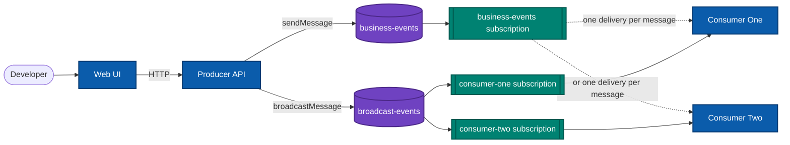
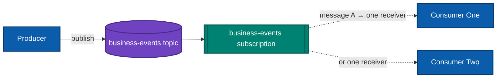
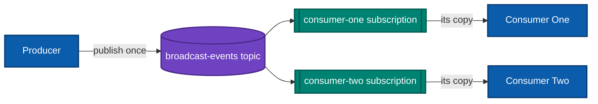

# Azure Service Bus Topics — Patterns in Practice

<p align="center">
  <strong>A small, runnable .NET Aspire app for seeing what Azure Service Bus topics actually do.</strong>
  <br />
  Compare <em>competing consumers</em> with <em>publish/subscribe</em>, send messages from a web UI, and follow each delivery in the Aspire dashboard — no Azure subscription required for the local demo.
</p>

<p align="center">
  
  
  
</p>

## What you'll learn

- How a **topic** fans messages out to its **subscriptions**.
- Why consumers sharing one subscription compete for each message.
- How independent subscriptions give each consumer its own copy.
- How to publish with `ServiceBusSender` and receive with `ServiceBusProcessor`.
- How .NET Aspire wires the producer, consumers, and local Service Bus emulator together.

## The app at a glance



The Web UI calls the Producer API. The API publishes to one of two topics; each topic's subscription topology determines which consumer receives the message. Aspire creates the local resources and supplies connection configuration to the services.

## Pattern 1: Competing consumers

**One topic → one shared subscription → multiple consumers.** Consumer One and Consumer Two both receive from `business-events/business-events`. For each message, Service Bus delivers it to **one** receiver on that subscription, not a copy to both. This lets you scale out workers that perform the same kind of work.



Both consumers attach to the same subscription name in [AppHost.cs](ServiceBusDemo.AppHost/AppHost.cs):

```csharp
var beTopic = asb.AddServiceBusTopic("businessEvent", topicName: "business-events");
var beSub = beTopic.AddServiceBusSubscription("business-events");

builder.AddProject<Projects.ServiceBusDemo_ConsumerOne>("consumer-one")
    .WithReference(asb)
    .WithEnvironment("ServiceBus__TopicName", beTopic.Resource.TopicName)
    .WithEnvironment("ServiceBus__SubscriptionName", beSub.Resource.SubscriptionName);

builder.AddProject<Projects.ServiceBusDemo_ConsumerTwo>("consumer-two")
    .WithReference(asb)
    .WithEnvironment("ServiceBus__TopicName", beTopic.Resource.TopicName)
    .WithEnvironment("ServiceBus__SubscriptionName", beSub.Resource.SubscriptionName);
```

The producer's `/sendMessage` endpoint uses the sender registered for that topic. It assigns a message ID and sends the message:

```csharp
var message = new ServiceBusMessage(request.Message)
{
    MessageId = Guid.NewGuid().ToString(),
    ContentType = "text/plain"
};

await sender.SendMessageAsync(message, cancellationToken);
```

**Good fit:** distribute independent jobs across equivalent workers. Competing consumers are not a broadcast mechanism; if both services need every event, use separate subscriptions instead.

## Pattern 2: Publish/subscribe (fan-out)

**One topic → one subscription per consumer.** `broadcast-events` has a `consumer-one` subscription and a `consumer-two` subscription. Service Bus places a copy of each published message in each subscription, so both consumers can process the same event independently and at their own pace.



Aspire declares a distinct subscription for each consumer. No subscription filters are configured in this demo, so both subscriptions receive every message sent to this topic:

```csharp
var broadcastTopic = asb.AddServiceBusTopic("broadcastEvent", topicName: "broadcast-events");
var consumerOneSub = broadcastTopic.AddServiceBusSubscription(
    "broadcast-consumer-one", subscriptionName: "consumer-one");
var consumerTwoSub = broadcastTopic.AddServiceBusSubscription(
    "broadcast-consumer-two", subscriptionName: "consumer-two");
```

The Producer API exposes this route as `/broadcastMessage`. Each consumer starts a processor for its own broadcast subscription as well as the shared competing-consumer subscription:

```csharp
var processor = client.CreateProcessor(topic, subscription, new ServiceBusProcessorOptions
{
    AutoCompleteMessages = false,
    MaxConcurrentCalls = 2
});

// Normal-path example. The failure lab can also abandon or dead-letter.
processor.ProcessMessageAsync += args =>
    args.CompleteMessageAsync(args.Message, args.CancellationToken);

await processor.StartProcessingAsync(stoppingToken);
```

**Good fit:** independent downstream systems that each need the event, such as notifications, analytics, and auditing.

## Run it locally

### Prerequisites

- [.NET 11 SDK](https://dotnet.microsoft.com/download)
- [Docker Desktop](https://www.docker.com/products/docker-desktop/) running (Aspire runs the Service Bus emulator in a container)

### Start the app

From the repository root:

```powershell
dotnet run --project ServiceBusDemo.AppHost
```

Aspire starts the emulator, creates both topics and their subscriptions, and launches the web UI, producer, and two consumers. Open the **webfrontend** endpoint shown in the Aspire dashboard, choose a pattern, enter a message, and select **Send**. The dashboard is also where you can inspect resource health and the consumer logs.

To observe the difference, send one message with each pattern and look at the consumer logs:

- **Competing consumers:** find `[CompetingConsumers]`; only one of the two consumers handles a given message in the normal case.
- **Publish/subscribe:** find `[PubSub]`; both consumers log the same message ID, each from its own subscription.

### Try the failure lab

- **Fail first N attempts** (1–10, default 2): abandon attempts 1 and 2 at the default setting, then complete attempt 3. The message ID stays the same. Pub/sub subscriptions retry independently; competing-consumer attempts can appear in either lane.
- **Poison message (always fail)** overrides fail-first. Intentional failures are abandoned on attempts 1–4 and explicitly dead-lettered on attempt 5 or later with reason `FailureLabAttemptLimit`. A fail-first count of 5 or higher also reaches that limit before succeeding. This is a demo decision, not a production retry policy.
- **Slow handler** (1–120 seconds, default 5) delays each attempt before settlement, even when combined with a failure option. Send a slow message, then send another with the option off: each processor has two concurrent slots. The default delay is shorter than the emulator's default lock duration. Cards show the **initial** lock expiration, settlement time, and elapsed handling time; automatic lock renewal can extend the lock, so choosing a long delay does not guarantee lock expiry.

The local Aspire emulator configuration sets the broker's `MaxDeliveryCount` to 5 on all three subscriptions. This is separate from the application's limit of 5: an external broker must allow at least five deliveries for the application to explicitly dead-letter on the fifth attempt. Lock loss, shutdown, or a lower broker limit can prevent that outcome. Reports are best-effort and emitted only after successful settlement; a missing card doesn't prove settlement failed.

**Design decision:** explicitly dead-letter on the fifth intentional failure instead of abandoning the fifth attempt and relying on the broker. This lets the lab report a confirmed `DeadLettered` settlement. Redelivery can repeat work, so real at-least-once handlers must be idempotent: applying the same message again must not repeat its business effects.

### Try a burst

Choose a pattern and enter a message. Set **Count** (1–500, default 10), leave **Limit rate** unchecked to go as fast as possible, or enable it and enter a whole-number rate (1–1000 messages per second). Select **Send burst** and watch the acknowledged-send progress and the two consumer bars. Try each pattern: with all reports arriving once, the competing-consumer bars sum to the acknowledged send count, while each pub/sub bar reaches that count.

The burst uses a snapshot of the selected failure options for every message. The Web UI loops sequentially over the existing producer routes rather than using a batch API. This keeps the per-message acknowledgements and lets the UI pace request starts and cancel between requests. A fixed rate is a cap, not a throughput guarantee. **Cancel burst** interrupts any pacing delay and stops new requests; it lets an already-started request finish and counts its acknowledgement if it succeeds. A failed request stops the burst without retrying: the producer may have accepted it even if the UI didn't receive confirmation.

Use **Cancel burst** and wait for it to finish before leaving if you want to see the final acknowledged count. Leaving or reloading during an active burst can interrupt it and loses the page's progress and statistics. The producer may still accept an in-flight message without the page receiving confirmation. The page shows this warning during the burst; reloads and tab closes use the browser's standard leave-page prompt when allowed.

The bars count **reported deliveries**, not broker backlog. They follow acknowledged IDs from the latest burst in this page session, including reports that arrive after sending stops. **Clear** removes shared delivery cards, not burst stats or sent history. Reports are best-effort and can be lost, and the UI warns if its bounded early-report buffer fills. Repeat reports for the same message and consumer count once; redelivery to a different competing consumer can put the total above expected.

### Pause and resume consumers

Each delivery lane has **Pause** and **Resume** buttons that control both subscriptions for that consumer without stopping its process. Pause waits for in-flight processing to finish. Resume starts the same processors again. The badges refresh automatically, including after changes from another tab. A consumer process restart starts both processors normally; pause is not persisted. **Mixed** means the two processors are in different states; retry Pause or Resume to bring them back to the same state.

1. Pause **Consumer Two** and wait for **Paused**. Send a competing-consumer message or burst. The new deliveries should appear in Consumer One's lane.
2. Pause **Consumer One** too. Send more competing-consumer messages and note their message IDs. Resume Consumer One and watch for those IDs in its lane as it processes the backlog.
3. With Consumer Two still paused, send a publish/subscribe message. Consumer One receives its own copy. Resume Consumer Two to see the other copy with the same message ID.

Pausing does not remove pending messages. Normal broker expiry still applies, and delivery reports are best-effort: a missing card does not prove a message wasn't processed. The badges report processor state, not broker backlog.

Consumer control endpoints are internal in Aspire. The Web app uses `GET /control/status` and sends `X-ServiceBusDemo-Control: 1` on `POST /control/pause` and `POST /control/resume`. This header blocks ordinary cross-site form submissions; it is **not authentication**, and cross-origin access is not enabled. Do not expose this unauthenticated demo, **including its Web UI**, to untrusted users or networks.

The Web frontend and both consumers accept only loopback hostnames by default (`localhost`, `127.0.0.1`, `[::1]`). For a different trusted setup, set `AllowedHosts` per app to an explicit semicolon-separated list of the hostnames it needs to accept, without ports or a wildcard. Host filtering does not authenticate callers.

### Run the tests

```powershell
dotnet test ServiceBusDemo.slnx
```

## Try the producer API directly

The Producer API has two POST routes. Use the producer endpoint URL shown in the Aspire dashboard in place of `<producer-url>`:

```bash
curl -X POST "<producer-url>/sendMessage" \
  -H "Content-Type: application/json" \
  -d '{"message":"Order 42 was placed"}'

curl -X POST "<producer-url>/broadcastMessage" \
  -H "Content-Type: application/json" \
  -d '{"message":"Order 42 was placed"}'
```

A successful request returns `202 Accepted` with the generated `messageId` and topic name. Both routes accept optional `failFirstCount` (integer 1–10), `alwaysFail` (boolean), and `delaySeconds` (integer 1–120). Selected options become the Service Bus application properties `fail-first-count`, `always-fail`, and `delay-seconds`. Requests with only `message` remain valid. Empty messages and invalid option values return `400 Bad Request` without publishing.

## Delivery event ingest

`POST /api/deliveries` on **webfrontend** accepts a JSON [`DeliveryEvent`](ServiceBusDemo.ServiceDefaults/DeliveryEvent.cs) and returns `202 Accepted` for a valid event. After successfully settling an attempt, each consumer queues a report that includes `deliveryCount`, `outcome` (`Completed`, `Abandoned`, or `DeadLettered`), `receivedAt`, `initialLockedUntil`, and `settledAt`. Each consumer can queue up to 256 reports and sends them in the background with a two-second timeout and no retries. If Web is unavailable or the reporting queue is full, reports may be lost without affecting Service Bus processing. Pending reports are discarded at shutdown.

The feed keeps the most recent 200 events in memory and loses them when the Web app restarts. The endpoint is unauthenticated and intended only for the local demo. Do not expose it publicly: any caller can submit events, and the 200-event cap limits the number of entries, not the size of each event.

## Project map

| Project | Role |
| --- | --- |
| [`ServiceBusDemo.AppHost`](ServiceBusDemo.AppHost/AppHost.cs) | Defines the emulator, topics, subscriptions, and service wiring. |
| [`ServiceBusDemo.Web`](ServiceBusDemo.Web/Components/Pages/Home.razor) | Interactive UI for selecting a pattern and publishing a message. |
| [`ServiceBusDemo.Producer`](ServiceBusDemo.Producer/Program.cs) | HTTP API and the two `ServiceBusSender` instances. |
| [`ServiceBusDemo.ConsumerOne`](ServiceBusDemo.ConsumerOne/MessageConsumer.cs) | Background worker listening to both topologies. |
| [`ServiceBusDemo.ConsumerTwo`](ServiceBusDemo.ConsumerTwo/MessageConsumer.cs) | Second worker; shares one subscription and has its own broadcast subscription. |
| [`ServiceBusDemo.Tests`](ServiceBusDemo.Tests/WebTests.cs) | Aspire integration test for both messaging patterns and reporting during Web outages. |

## A few Service Bus details worth keeping in mind

- A **topic** is the publish endpoint; a **subscription** is an independently consumable view of messages published to that topic.
- A subscription is a durable messaging entity, not just a listener. Its messages remain available to that subscription until they are completed, expired, or otherwise removed under the entity's rules.
- Competing consumers share the subscription's work. Separate subscriptions each get their own copy. To add a new subscriber, create a new subscription.
- Delivery is generally **at least once**. A process failure or lock expiry can result in redelivery, so real handlers should be safe to run more than once. This demo illustrates settlement and redelivery without performing real business processing.
- This project uses Aspire's **local Service Bus emulator** for development. For Azure, provision the entities and configure the client to use an Azure namespace and an appropriate identity/credential; don't treat the local emulator as a production broker.

## Extend the demo

1. Add a subscription in `ServiceBusDemo.AppHost/AppHost.cs`.
2. Pass its topic and subscription names to the intended consumer with `WithEnvironment`.
3. Add a processor for that entity in the consumer's `MessageConsumer`.
4. Publish a message and verify the resulting logs in the Aspire dashboard.

If this helped you understand the patterns, a ⭐ on the repo is always appreciated!
