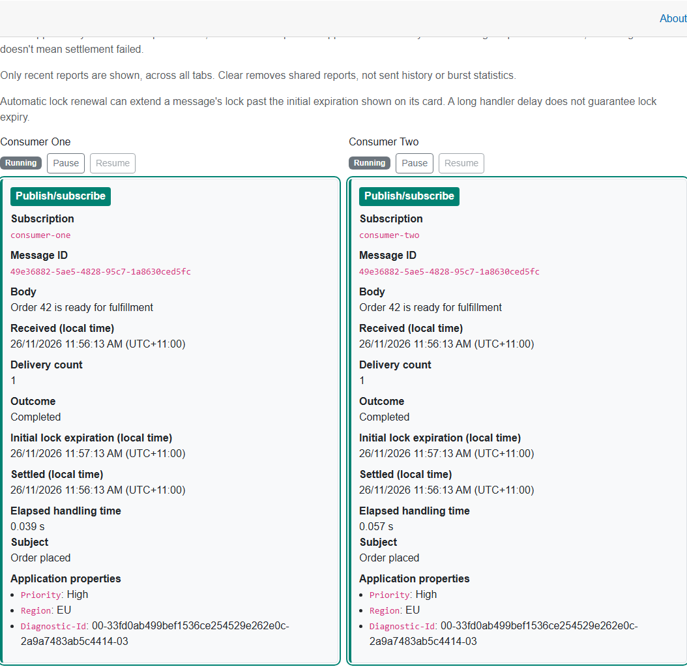
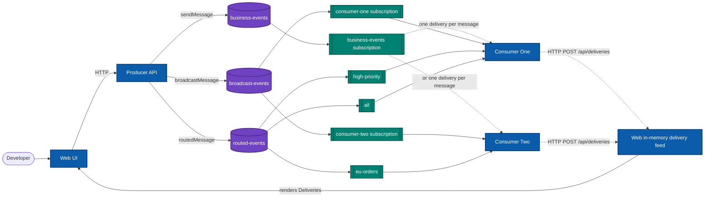
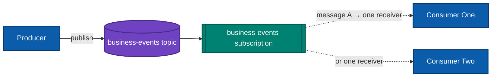
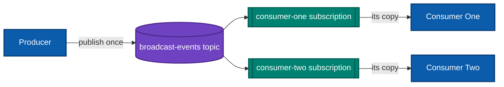

# Azure Service Bus Topics — Patterns in Practice

<p align="center">
  <strong>A small, runnable .NET Aspire app for seeing what Azure Service Bus topics actually do.</strong>
  <br />
  Compare <em>competing consumers</em>, <em>publish/subscribe</em>, and <em>topic filters</em>, send messages from a web UI, and follow deliveries — no Azure subscription required for the local demo.
</p>

<p align="center">
  
  
  
</p>

## What you can try

- In **Messaging**, compare **Competing consumers**, **Publish/subscribe**, and **Topic filters** with a local Service Bus emulator.
- In **Deliveries**, watch cards appear in each consumer's lane after settlement. Hover over or focus a card to highlight other visible reports with the same **Message ID**.
- Add metadata in **Advanced** and compare **Sent this session** with what the consumers received. Use **Burst sender** to track acknowledged sends and reported deliveries.
- **Pause** and **Resume** consumers and watch **Subscription depth** estimates change as reports arrive.
- Use **Failure lab** to see retries, slow handling, and dead-lettering. In **Dead-letter**, inspect messages, **Resubmit** a copy, or **Purge** the original.



One publish, two subscriptions: both completed cards show the same **Message ID** but different **Subscription** values.

## The app at a glance



The Web UI calls the Producer API. The API publishes to one of three topics; each topic's subscriptions determine which consumers receive the message. Aspire creates the local resources and supplies connection configuration to the services.

The subscription-to-consumer arrows show Service Bus delivery. The HTTP arrows show [best-effort reports](#delivery-event-ingest) sent by both consumers **after** successful settlement. Reporting is not part of broker settlement: a missing card does not mean the message wasn't processed.

## Pattern 1: Competing consumers

**One topic → one shared subscription → multiple consumers.** Consumer One and Consumer Two both receive from `business-events/business-events`. For each message, Service Bus delivers it to **one** receiver on that subscription, not a copy to both. This lets you scale out workers that perform the same kind of work.



Both consumers attach to the same subscription name in [AppHost.cs](ServiceBusDemo.AppHost/AppHost.cs):

```csharp
var beTopic = asb.AddServiceBusTopic("businessEvent", topicName: "business-events");
var beSub = beTopic.AddServiceBusSubscription("business-events");

builder.AddProject<Projects.ServiceBusDemo_ConsumerOne>("consumer-one")
    .WithReference(asb)
    .WithEnvironment("ServiceBus__TopicName", beTopic.Resource.TopicName)
    .WithEnvironment("ServiceBus__SubscriptionName", beSub.Resource.SubscriptionName);

builder.AddProject<Projects.ServiceBusDemo_ConsumerTwo>("consumer-two")
    .WithReference(asb)
    .WithEnvironment("ServiceBus__TopicName", beTopic.Resource.TopicName)
    .WithEnvironment("ServiceBus__SubscriptionName", beSub.Resource.SubscriptionName);
```

The producer's `/sendMessage` endpoint uses the sender registered for that topic. It assigns a message ID and sends the message:

```csharp
var message = new ServiceBusMessage(request.Message)
{
    MessageId = Guid.NewGuid().ToString(),
    ContentType = "text/plain"
};

await sender.SendMessageAsync(message, cancellationToken);
```

**Good fit:** distribute independent jobs across equivalent workers. Competing consumers are not a broadcast mechanism; if both services need every event, use separate subscriptions instead.

## Pattern 2: Publish/subscribe (fan-out)

**One topic → one subscription per consumer.** `broadcast-events` has a `consumer-one` subscription and a `consumer-two` subscription. Service Bus places a copy of each published message in each subscription, so both consumers can process the same event independently and at their own pace.



Aspire declares a distinct subscription for each consumer. No subscription filters are configured in this demo, so both subscriptions receive every message sent to this topic:

```csharp
var broadcastTopic = asb.AddServiceBusTopic("broadcastEvent", topicName: "broadcast-events");
var consumerOneSub = broadcastTopic.AddServiceBusSubscription(
    "broadcast-consumer-one", subscriptionName: "consumer-one");
var consumerTwoSub = broadcastTopic.AddServiceBusSubscription(
    "broadcast-consumer-two", subscriptionName: "consumer-two");
```

The Producer API exposes this route as `/broadcastMessage`. Each consumer starts a processor for its own broadcast subscription as well as the shared competing-consumer subscription:

```csharp
var processor = client.CreateProcessor(topic, subscription, new ServiceBusProcessorOptions
{
    AutoCompleteMessages = false,
    MaxConcurrentCalls = 2
});

// Normal-path example. The failure lab can also abandon or dead-letter.
processor.ProcessMessageAsync += args =>
    args.CompleteMessageAsync(args.Message, args.CancellationToken);

await processor.StartProcessingAsync(stoppingToken);
```

**Good fit:** independent downstream systems that each need the event, such as notifications, analytics, and auditing.

## Pattern 3: Topic filters

The broker evaluates each subscription independently on `routed-events`:

| Subscription | Rule | Consumer |
| --- | --- | --- |
| `high-priority` | `Priority = 'High'` | Consumer One |
| `eu-orders` | `Region = 'EU'` | Consumer Two |
| `all` | Unfiltered | Consumer One |

AppHost uses Aspire 13.6.5's subscription `Rules` API to declare one correlation rule per filtered subscription. Aspire serializes the rules into the emulator's startup configuration. Each filtered subscription starts with its configured rule only, not a default match-all rule. `all` has no custom rules and receives every message. The producer waits for the routed subscriptions; no separate setup command or consumer-side filtering is needed.

In the UI, select **Topic filters** and enter a message and optional **Priority** and **Region** values. Try `High` alone, `EU` alone, both together, and neither. Both matching values route to all three subscriptions; neither (including nonmatching values) routes only to `all`. Consumer One can show two cards with the same message ID because it owns two distinct routed subscriptions.

The sent history lists reported subscriptions by message ID, using only retained events. Clearing the feed or its capacity limit can remove these reports without changing sent history. Missing reports do not prove non-delivery. **Topic filters** sends one message at a time; the burst sender is disabled for this pattern.

## Run it locally

### Prerequisites

- [.NET 11 SDK](https://dotnet.microsoft.com/download)
- [Docker Desktop](https://www.docker.com/products/docker-desktop/) running (Aspire runs the Service Bus emulator in a container)

### Start the app

From the repository root:

```powershell
dotnet run --project ServiceBusDemo.AppHost
```

Aspire starts the emulator with all three topics and their subscriptions, and launches the Web UI, producer, and two consumers. Once the resources are healthy, open **webfrontend** from the Aspire dashboard. Watch **Deliveries** first; use the dashboard's resource health and consumer logs to troubleshoot missing or unexpected reports.

### Suggested demo script

1. **Share work.** In **Messaging**, choose **Competing consumers**, enter `Order 41 placed` in **Message**, and select **Send**. Find the ID in **Sent this session** and the matching `Completed` card in either lane of **Deliveries**. The consumers share one `business-events` subscription, so one consumer handles the normal delivery. Don't promise alternating lanes.
2. **Fan out and compare metadata.** Choose **Publish/subscribe**. Open **Advanced**, set **Subject** to `Order placed`, and use **Add property** to add `Source` = `Demo`. Send `Order 42 placed`. Compare the [metadata](#add-message-metadata) in **Sent this session** and the two cards. Hover over or focus a card to highlight its counterpart: same ID, but `consumer-one` and `consumer-two` are independent subscriptions.
3. **Route by properties.** Choose **Topic filters**, set **Priority** to `High` and **Region** to `EU` under **Routing properties**, and send `Priority EU order`. Find three cards with the same ID: `high-priority` and `all` in Consumer One, and `eu-orders` in Consumer Two. Send again with both fields blank to show that only `all` matches. The broker evaluates each rule independently; the **Burst sender** is unavailable for this pattern.
4. **Compare bursts.** With both consumers running and failure options off, set **Count** to `5` in **Burst sender**. Try **Send burst** once per pattern: **Competing consumers**, then **Publish/subscribe**. With all reports arriving once, the shared lanes add to five, while the broadcast lanes each reach five. To show pacing and cancellation, use **Limit rate**, set **Rate** to `1`, and select **Cancel burst** before the burst finishes. The [bars count reports](#try-a-burst), not queued work.
5. **Pause, send, and drain.** Reload Home for fresh sent history. Under **Deliveries**, select **Pause** in both lanes and wait for **Paused**. Enter a fresh **Message**, then send a **Competing consumers** burst with **Count** set to `2`; **Estimated pending** should rise to two for the shared subscription. **Resume** Consumer One and watch its cards arrive and the estimate return to zero. Send one publish/subscribe message: Consumer Two's estimate stays at one until you **Resume** it. Explain that [SDK counts are unavailable and the UI estimates depth](#subscription-depth-in-the-emulator).
6. **Show retries and concurrency.** In **Publish/subscribe**, enable **Fail first N attempts**, leave the count at two, and send. Each subscription should show two `Abandoned` cards and then `Completed` for the same ID. Turn fail-first off, send with **Slow handler** set to ten seconds, then turn it off and send a normal message. The normal cards can appear first because each processor has two concurrent slots. The delayed card shows the initial lock expiration, not any renewal; a long delay [does not guarantee lock expiry](#try-the-failure-lab).
7. **Recover a poison message.** With the other failure options off, choose **Competing consumers**, enable **Poison message (always fail)**, and send. Follow the same ID from four abandons to [explicit dead-lettering on attempt five](#try-the-failure-lab). Open **Dead-letter**, select `business-events / business-events` under **Topic / subscription**, and inspect `FailureLabAttemptLimit`. Choose **Resubmit**; return to **Messaging** and watch for a completed card with the same body and a new ID. To show deletion instead, create another poison message and use **Purge**, then **Confirm purge**. Explain the [recovery limits](#inspect-and-recover-dead-letters): resubmission can create other copies, and publishing and removing the original are not atomic.

### Add message metadata

- **Competing consumers** and **Publish/subscribe**: In **Advanced**, select an optional **Priority** (`Low`, `Normal`, or `High`) and enter an optional **Region**. These settings apply to single sends and bursts. A burst captures the Advanced settings once and uses them for every message.
- **Topic filters**: Enter optional **Priority** and **Region** values under **Routing properties**, not **Advanced**. Use these fields rather than custom rows named `Priority` or `Region`. Burst sending is disabled; send one message at a time.

For any pattern, use **Advanced** to set an optional **Subject** or add and remove custom key/value rows. Blank Subject and Region and a blank or unselected Priority field are omitted. The dedicated fields send `Priority` and `Region` as application properties. Custom rows require both a key and a value; keys cannot duplicate another row or a populated Advanced field for Priority or Region, ignoring case.

**Sent this session** shows the metadata captured for each acknowledged send; delivery cards show the metadata the consumers actually received from the broker.

### Try the failure lab

- **Fail first N attempts** (1–10, default 2): abandon attempts 1 and 2 at the default setting, then complete attempt 3. The message ID stays the same. Pub/sub subscriptions retry independently; competing-consumer attempts can appear in either lane.
- **Poison message (always fail)** overrides fail-first. Intentional failures are abandoned on attempts 1–4 and explicitly dead-lettered on attempt 5 or later with reason `FailureLabAttemptLimit`. A fail-first count of 5 or higher also reaches that limit before succeeding. This is a demo decision, not a production retry policy.
- **Slow handler** (1–120 seconds, default 5) delays each attempt before settlement, even when combined with a failure option. Send a slow message, then send another with the option off: each processor has two concurrent slots. The default delay is shorter than the emulator's default lock duration. Cards show the **initial** lock expiration, settlement time, and elapsed handling time; automatic lock renewal can extend the lock, so choosing a long delay does not guarantee lock expiry.

The local Aspire emulator configuration sets the broker's `MaxDeliveryCount` to 5 on every subscription, including the routed subscriptions. This is separate from the application's limit of 5: an external broker must allow at least five deliveries for the application to explicitly dead-letter on the fifth attempt. Lock loss, shutdown, or a lower broker limit can prevent that outcome. Reports are best-effort and emitted only after successful settlement; a missing card doesn't prove settlement failed.

**Design decision:** explicitly dead-letter on the fifth intentional failure instead of abandoning the fifth attempt and relying on the broker. This lets the lab report a confirmed `DeadLettered` settlement. Redelivery can repeat work, so real at-least-once handlers must be idempotent: applying the same message again must not repeat its business effects.

### Inspect and recover dead letters

1. Send with **Poison message (always fail)** enabled and the other failure options off. Open Home's **Dead-letter** tab and choose the matching topic and subscription, including any routed subscription. The view automatically refreshes every two seconds while open and shows the reason, description, body, properties, and delivery count. Use **Refresh**, **Previous page**, and **Next page** to browse. Viewing uses non-destructive peek; a page is not a broker count.
2. **Resubmit** publishes a new message ID with the original body, subject, correlation ID, content type, and application properties except `always-fail` (case-insensitive), then completes the selected original. Republishing to the topic can deliver additional copies to other matching subscriptions. Retained `fail-first-count` or other properties can cause another failure. A successful publish does not guarantee processing, and a missing delivery report does not prove processing failed.
3. **Purge** asks you to confirm the topic, subscription, and sequence number before completing just that original without sending a copy. Service Bus cannot lock an arbitrary peeked sequence directly: the API holds other messages while searching up to five batches of ten and abandons their locks in cleanup. This can temporarily lock unrelated messages and affect their delivery counts. If the target cannot be locked in the bounded search, no message is completed.

Publish and completion are not atomic. An unconfirmed send leaves the original uncompleted; an unconfirmed completion can leave the original in the dead-letter queue after the new copy has already been sent. Recovery uses a separate Service Bus client and senders with automatic retries disabled, leaving ordinary sends unchanged. Wait for the result before leaving or reloading the page. If you lose the result or the outcome is uncertain, refresh the subscription and investigate whether a copy was published or processed before retrying. Retrying a resubmit can create duplicates even if the original is still listed.

**Design decision:** the dead-letter endpoints are in the Producer API, which already owns the Service Bus client, topic senders, and Web's typed client connection. The API only accepts topic/subscription pairs from the AppHost topology. These are demo endpoints without production authentication or authorization; do not expose them to untrusted callers.

### Try a burst

Choose **Competing consumers** or **Publish/subscribe** and enter a message. Set **Count** (1–500, default 10), leave **Limit rate** unchecked to go as fast as possible, or enable it and enter a whole-number rate (1–1000 messages per second). Select **Send burst** and watch the acknowledged-send progress and the two consumer bars. With all reports arriving once, the competing-consumer bars sum to the acknowledged send count, while each pub/sub bar reaches that count.

The burst uses a snapshot of the selected failure options for every message. The Web UI loops sequentially over the existing producer routes rather than using a batch API. This keeps the per-message acknowledgements and lets the UI pace request starts and cancel between requests. A fixed rate is a cap, not a throughput guarantee. **Cancel burst** interrupts any pacing delay and stops new requests; it lets an already-started request finish and counts its acknowledgement if it succeeds. A failed request stops the burst without retrying: the producer may have accepted it even if the UI didn't receive confirmation.

Use **Cancel burst** and wait for it to finish before leaving if you want to see the final acknowledged count. Leaving or reloading during an active burst can interrupt it and loses the page's progress and statistics. The producer may still accept an in-flight message without the page receiving confirmation. The page shows this warning during the burst; reloads and tab closes use the browser's standard leave-page prompt when allowed.

The bars count **reported deliveries**, not broker backlog. They follow acknowledged IDs from the latest burst in this page session, including reports that arrive after sending stops. **Clear** removes shared delivery cards, not burst stats or sent history. Reports are best-effort and can be lost, and the UI warns if its bounded early-report buffer fills. Repeat reports for the same message and consumer count once; redelivery to a different competing consumer can put the total above expected.

### Pause and resume consumers

Each delivery lane has **Pause** and **Resume** buttons that control all processors for that consumer without stopping its process. Pause waits for in-flight processing to finish. Resume starts the same processors again. The badges refresh automatically, including after changes from another tab. A consumer process restart starts all its processors normally; pause is not persisted. **Mixed** means processors are in different states; retry Pause or Resume to bring them back to the same state.

1. Pause **Consumer Two** and wait for **Paused**. Send a competing-consumer message or burst. The new deliveries should appear in Consumer One's lane.
2. Pause **Consumer One** too. Send more competing-consumer messages and note their message IDs. Resume Consumer One and watch for those IDs in its lane as it processes the backlog.
3. With Consumer Two still paused, send a publish/subscribe message. Consumer One receives its own copy. Resume Consumer Two to see the other copy with the same message ID.

Pausing does not remove pending messages. Normal broker expiry still applies, and delivery reports are best-effort: a missing card does not prove a message wasn't processed. The badges report processor state, not broker backlog.

Consumer control endpoints are internal in Aspire. The Web app uses `GET /control/status` and sends `X-ServiceBusDemo-Control: 1` on `POST /control/pause` and `POST /control/resume`. This header blocks ordinary cross-site form submissions; it is **not authentication**, and cross-origin access is not enabled. Do not expose this unauthenticated demo, **including its Web UI**, to untrusted users or networks.

The Web frontend and both consumers accept only loopback hostnames by default (`localhost`, `127.0.0.1`, `[::1]`). For a different trusted setup, set `AllowedHosts` per app to an explicit semicolon-separated list of the hostnames it needs to accept, without ports or a wildcard. Host filtering does not authenticate callers.

### Subscription depth in the emulator

**Result: the management call responds, but does not provide usable active or dead-letter counts through the SDK.**
Microsoft's [emulator overview and limitations](https://learn.microsoft.com/en-us/azure/service-bus-messaging/overview-emulator) describe .NET entity management, and the [local testing guide](https://learn.microsoft.com/en-us/azure/service-bus-messaging/test-locally-with-service-bus-emulator) specifies the separate HTTP management port (5300 by default). That does not guarantee that subscription runtime counts decode correctly.

The AppHost launched with `dotnet run --project ServiceBusDemo.AppHost` selected `mcr.microsoft.com/azure-messaging/servicebus-emulator:2.0.0`. To keep it running for the probe, the same AppHost was started detached with `aspire start --apphost ServiceBusDemo.AppHost --no-build -lp https`. Docker was remote in this environment: host-loopback checks timed out or refused connections, so the probe shared the emulator container's network namespace and used `Endpoint=sb://127.0.0.1:5300;...;UseDevelopmentEmulator=true` for management and port 5672 for AMQP.

With Azure.Messaging.ServiceBus 7.20.2, `ServiceBusAdministrationClient.GetSubscriptionRuntimePropertiesAsync` returned HTTP 200 on all three configured subscriptions. After sending with no receivers, completing shared messages and dead-lettering a broadcast copy, the SDK still reported `ActiveMessageCount=0` and `DeadLetterMessageCount=0` throughout. AMQP peek independently found two active messages and one dead-letter on `broadcast-events/consumer-one`, and three active messages on `broadcast-events/consumer-two`. The HTTP bodies had `MessageCount=3` and count details with nonstandard XML names (for example, `iqV` and `iqv`), not the named SDK count fields. This is not a startup failure or evidence of an empty subscription. `SubscriptionRuntimeProperties` also has no `ScheduledMessageCount` property; even with a future-dated send in the probe there was no named scheduled count available from this call.

Home's subscription depth section shows **Estimated pending** and **Dead-letter count: unavailable** for each listed subscription. Use the separate **Dead-letter** tab to inspect messages without relying on a broker count. The depth estimate counts distinct acknowledged message IDs for the row's topic that have no matching report for that topic and subscription in the current delivery feed. Either consumer can satisfy the shared subscription's report; broadcast subscriptions are counted independently. There is no broker polling for these estimates.

The estimate covers only sends acknowledged on this page, not external sends or sends in other tabs. Any matching settlement report reduces the estimate, even an abandonment that leaves the message eligible for redelivery. Reports are best-effort, and the feed retains only the most recent 200. Clearing the feed or evicting an older report can increase the estimate; reloading loses this page's sent history.

To walk through the estimate, start with a fresh Home page:

1. Pause both consumers and wait for both badges to show **Paused**. Send a competing-consumer burst of two. Only the shared row should rise, to two.
2. Resume Consumer One. Watch the shared row return to zero as its reports arrive.
3. With Consumer Two still paused, send one publish/subscribe message. The `consumer-one` copy should quickly return to zero after its report; `consumer-two` should stay at one until you resume Consumer Two and its report arrives.

Verified separately in Chromium against the running AppHost and emulator: the shared estimate rose from 0 to 2 with both consumers paused and returned to 0 after resuming Consumer One. A broadcast then left Consumer Two's estimate at 1 while Consumer One's was 0; resuming Consumer Two returned all three rows to 0. The UI sequence is also covered in bUnit with simulated control and delivery responses.

### Run the tests

The full suite requires the .NET 11 SDK and running Docker; the Aspire integration test starts a real local Service Bus emulator and checks the running Web app's rendered delivery cards.

```powershell
dotnet test ServiceBusDemo.slnx
```

To run the single-send validation tests in Chromium with Node.js and npm installed (no Docker required):

```powershell
npm --prefix ServiceBusDemo.Tests/browser ci
npm --prefix ServiceBusDemo.Tests/browser run install-browser
npm --prefix ServiceBusDemo.Tests/browser test
```

## Try the producer API directly

The Producer API has three POST routes. Use the producer endpoint URL shown in the Aspire dashboard in place of `<producer-url>`:

```bash
curl -X POST "<producer-url>/sendMessage" \
  -H "Content-Type: application/json" \
  -d '{"message":"Order 42 was placed"}'

curl -X POST "<producer-url>/broadcastMessage" \
  -H "Content-Type: application/json" \
  -d '{"message":"Order 42 was placed"}'

curl -X POST "<producer-url>/routedMessage" \
  -H "Content-Type: application/json" \
  -d '{"message":"Priority order","priority":"High"}'

curl -X POST "<producer-url>/routedMessage" \
  -H "Content-Type: application/json" \
  -d '{"message":"EU order","region":"EU"}'

curl -X POST "<producer-url>/routedMessage" \
  -H "Content-Type: application/json" \
  -d '{"message":"Priority EU order","priority":"High","region":"EU"}'

curl -X POST "<producer-url>/routedMessage" \
  -H "Content-Type: application/json" \
  -d '{"message":"Standard order"}'
```

A routed request maps nonempty string `priority` and `region` values to the broker application properties `Priority` and `Region` respectively.
A successful request returns `202 Accepted` with the generated `messageId` and topic name. All three routes accept optional `failFirstCount` (integer 1–10), `alwaysFail` (boolean), and `delaySeconds` (integer 1–120). Selected options become the Service Bus application properties `fail-first-count`, `always-fail`, and `delay-seconds`. Requests with only `message` remain valid. Empty messages, invalid option values, and invalid metadata return `400 Bad Request` without publishing.

All three routes also accept optional `subject`, `correlationId`, and a string-valued `applicationProperties` object. Existing message-only requests still work, and each optional field can be omitted or set to `null`. For example:

```json
{
  "message": "Order 42 was placed",
  "subject": "Order placed",
  "correlationId": "order-42",
  "applicationProperties": { "Priority": "High", "Region": "West" }
}
```

Subject, CorrelationId, and application-property keys are limited to 128 characters; property values are limited to 1024. Supplied strings must contain a non-whitespace character, and property values cannot be null. Valid text is preserved without trimming. Invalid metadata returns `400 Bad Request` without sending. CorrelationId is set through the API, not the UI.

## Delivery event ingest

`POST /api/deliveries` on **webfrontend** accepts a JSON [`DeliveryEvent`](ServiceBusDemo.ServiceDefaults/DeliveryEvent.cs) and returns `202 Accepted` for a valid event. After successfully settling an attempt, each consumer queues a report that includes `deliveryCount`, `outcome` (`Completed`, `Abandoned`, or `DeadLettered`), `receivedAt`, `initialLockedUntil`, and `settledAt`. Each consumer can queue up to 256 reports and sends them in the background with a two-second timeout and no retries. If Web is unavailable or the reporting queue is full, reports may be lost without affecting Service Bus processing. Pending reports are discarded at shutdown.

Reports may include the broker's `subject`, `correlationId`, and `applicationProperties`. Application-property values from other producers are formatted as strings for display; older reports can omit all metadata.

The feed keeps the most recent 200 events in memory and loses them when the Web app restarts. The endpoint is unauthenticated and intended only for the local demo. Do not expose it publicly: any caller can submit events, and the 200-event cap limits the number of entries, not the size of each event.

## Project map

| Project | Role |
| --- | --- |
| [`ServiceBusDemo.AppHost`](ServiceBusDemo.AppHost/AppHost.cs) | Defines the emulator, topics, subscriptions, and service wiring. |
| [`ServiceBusDemo.Web`](ServiceBusDemo.Web/Components/Pages/Home.razor) | Interactive UI for selecting a pattern and publishing a message. |
| [`ServiceBusDemo.Producer`](ServiceBusDemo.Producer/Program.cs) | HTTP API with a `ServiceBusSender` for each topic. |
| [`ServiceBusDemo.ConsumerOne`](ServiceBusDemo.ConsumerOne/MessageConsumer.cs) | Worker listening to shared, broadcast, `high-priority`, and `all` subscriptions. |
| [`ServiceBusDemo.ConsumerTwo`](ServiceBusDemo.ConsumerTwo/MessageConsumer.cs) | Worker listening to shared, broadcast, and `eu-orders` subscriptions. |
| [`ServiceBusDemo.Tests`](ServiceBusDemo.Tests/WebTests.cs) | Aspire integration test for all patterns and reporting during Web outages. |

## A few Service Bus details worth keeping in mind

- A **topic** is the publish endpoint; a **subscription** is an independently consumable view of messages published to that topic.
- A subscription is a durable messaging entity, not just a listener. Its messages remain available to that subscription until they are completed, expired, or otherwise removed under the entity's rules.
- Competing consumers share the subscription's work. Separate subscriptions each get their own copy. To add a new subscriber, create a new subscription.
- Delivery is generally **at least once**. A process failure or lock expiry can result in redelivery, so real handlers should be safe to run more than once. This demo illustrates settlement and redelivery without performing real business processing.
- This project uses Aspire's **local Service Bus emulator** for development. For Azure, provision the entities and configure the client to use an Azure namespace and an appropriate identity/credential; don't treat the local emulator as a production broker.

## Extend the demo

1. Add a subscription in `ServiceBusDemo.AppHost/AppHost.cs`.
2. Pass its topic and subscription names to the intended consumer with `WithEnvironment`.
3. Add a processor for that entity in the consumer's `MessageConsumer`.
4. Publish a message and check **Deliveries** for the message ID and subscription. If a card is missing, check the consumer logs in the Aspire dashboard.

If this helped you understand the patterns, a ⭐ on the repo is always appreciated!
